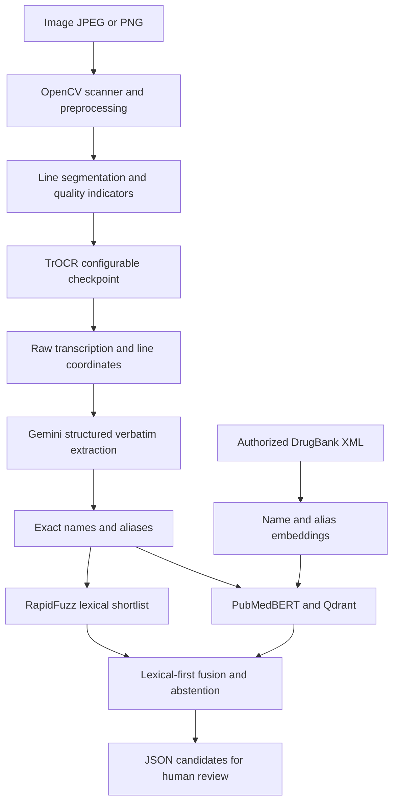

# Medical-HTR — handwritten prescription transcription and drug entity linking

Research prototype; not a clinically validated tool. It transcribes images, extracts verbatim medication mentions and proposes DrugBank candidates for human review. It does not confirm prescriptions, doses, treatments or drug safety.

## Architecture (V2)



FastAPI orchestrates the pipeline via POST /extract. Exact aliases bypass fuzzy/vector search; when no exact match exists, vector results only rerank lexically plausible candidates. Gemini extracts fields before retrieval, so this is **information extraction + hybrid retrieval/entity linking**, not generative RAG. The raw OCR text is preserved. Bounding boxes refer to the deskewed/scanned image; quality score is an image heuristic, not calibrated OCR confidence. Human review is always required.

## Files
- scanner.py, preprocessing.py, segmentation.py: existing OpenCV modules adapted to in-memory processing.
- extraction.py: TrOCR inference.
- correction.py: Gemini verbatim extraction with Pydantic schema and substring checks.
- ingest_drugbank.py, retrieval.py: consistent PubMedBERT indexing and hybrid search.
- pipeline.py, schemas.py, config.py: orchestration, data contracts and settings.
- api/main.py: real API, lazy initialization and explicit errors.
- notebooks/fine.ipynb, notebooks/RAG.ipynb: unchanged historical experiments.

## Historical evidence and current limitations

The archived notebook reports 3,120 training, 780 validation and 780 test images and CER 3.10% on its test set. It appears to concern medication-name crops, not full prescription accuracy. Fine-tuned weights are unavailable; the notebook and its outputs are retained, not independently reproduced. The historical retrieval experiment reports 10,562 indexed records. V2 changes the representation to names/aliases for identity matching and requires rebuilding the index. Historical retrieval results are not V2 results. The lexical cutoff (70) and RRF weights are uncalibrated heuristics. The integration has not been exercised end-to-end, and dependency ranges are not a tested lockfile. No synthetic performance claims are made.

## Local setup (Python 3.11 recommended)

```bash
python -m venv .venv
source .venv/bin/activate
pip install -r requirements.txt
cp .env.example .env
```

Restore the complete fine-tuned model and processor to TROCR_MODEL_PATH if available. Otherwise explicitly set TROCR_ALLOW_BASE_FALLBACK=true for a generic model demo; the historical CER does not apply. Use CPU by default or set TROCR_DEVICE=cuda on a compatible machine.

Use a licensed/authorized DrugBank XML export, never commit it or generated artifacts. Build a new local index (not the historical MiniLM or in-memory index):

```bash
python ingest_drugbank.py /path/to/drugbank.xml
```

Optional smoke index: use --limit 10 and a separate --db-path, then point QDRANT_PATH there; it is not a full database. Set GEMINI_API_KEY and GEMINI_ALLOW_EXTERNAL_TEXT=true only for authorized non-sensitive demonstration inputs. Gemini receives OCR text, potentially containing personal information: do not use real patient records without an appropriate legal/privacy framework. No external text is sent by default.

```bash
uvicorn api.main:app --host 127.0.0.1 --port 8000 --workers 1
curl -F 'file=@demo.png;type=image/png' http://127.0.0.1:8000/extract
```

GET / reports API liveness and whether the pipeline is initialized, not clinical readiness. POST /extract returns HTTP 503 if required artifacts or configuration are absent; there are no simulated successful results. Local Qdrant requires a single process. No deployment, public exposure, or clinical use is intended.

## Minimal verification to perform when artifacts are available

```bash
python -m compileall -q scanner.py preprocessing.py segmentation.py extraction.py correction.py ingest_drugbank.py retrieval.py pipeline.py schemas.py config.py api
```

Then verify model loading, index consistency, missing-artifact errors, synthetic OCR examples and one authorized image. Evaluate CER/WER/exact match and retrieval precision/recall/false positives independently before claiming improvements.
