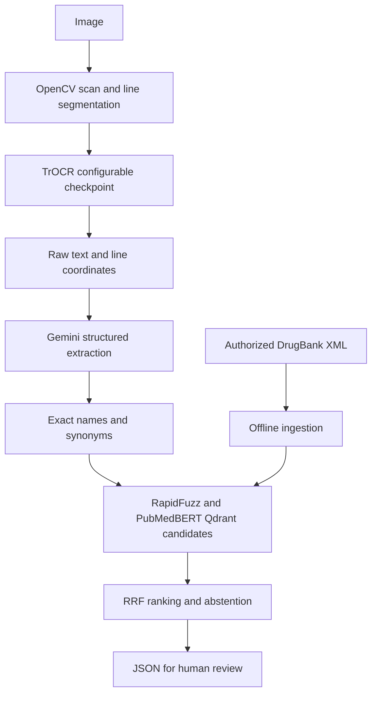

# Medical-HTR V2

Research prototype for handwritten prescription transcription and drug entity linking. Not a clinically validated system; every output requires professional review. No prescribing or dosage verification.

## Architecture



FastAPI orchestrates these stages. Gemini extracts verbatim fields and does not generate answers from retrieved documents: this is information extraction and hybrid entity linking, not full RAG. The standalone preprocessing module remains available for experimentation; segmentation performs its own binarization. Bounding boxes use the scanned/deskewed image coordinate frame.

## Historical experiments and current limitations

The original notebooks are preserved. The historical TrOCR run reports 3120 training, 780 validation and 780 test images, with test CER 3.10%. These are archived results, not reproduced results for V2 or for full prescriptions. The fine-tuned checkpoint is currently unavailable; it cannot be recovered from the notebook alone. The original retrieval notebook reports 10562 indexed documents. The new index embeds drug names and stores synonyms as payload for lexical matching, using a single configurable encoder at ingestion and query time. Its performance and threshold are not validated.

V2 is a code refactor, not an executed end-to-end demonstration. No training, indexing, external API calls or clinical evaluation were performed for this revision. Dependencies are not locked or integration-tested.

## Setup (proposed, not verified)

Python 3.11 recommended.

```bash
python -m venv .venv
source .venv/bin/activate
pip install -r requirements.txt
cp .env.example .env
```

Place an actual fine-tuned checkpoint including its processor under the configured TROCR_MODEL_PATH. Alternatively set ALLOW_BASE_MODEL=true explicitly to use Microsoft's original model; the response identifies the model mode. Historical CER does not apply to this fallback.

Use only authorized, de-identified or synthetic images. External Gemini calls are disabled by default; enabling them requires authorization to transmit the OCR content and a valid GEMINI_API_KEY. With external calls disabled the API returns raw OCR only.

For full extraction and retrieval, rebuild a fresh index using the authorized DrugBank XML (not included; respect its license):

```bash
python ingest_drugbank.py Data/drugbank.xml
uvicorn api.main:app --host 127.0.0.1 --port 8000
```

Set ALLOW_EXTERNAL_LLM=true in .env to enable the full pipeline. Start one worker for the embedded local Qdrant store. Use /docs to submit a JPEG or PNG to POST /extract. Missing artifacts cause an explicit service error, never a simulated result.

## Modules

- scanner.py, preprocessing.py, segmentation.py: original vision modules.
- extraction.py: checkpoint loading and TrOCR inference.
- correction.py: constrained Gemini extraction, literal source checks.
- ingest_drugbank.py: XML parsing and offline vector index.
- retrieval.py: exact matching, fuzzy matching, semantic retrieval and reciprocal rank fusion. Lexical gate is a provisional heuristic; no score is a calibrated probability.
- pipeline.py: orchestration, temporary file cleanup.
- schemas.py, config.py, api/main.py: contracts, configuration and HTTP interface.
- notebooks/: historical research experiments.

Known limitations: segmentation may miss lines; OCR may misread names and units; Gemini may omit or misclassify mentions; DrugBank coverage may be incomplete. Candidates are never automatically confirmed. No patient-identifying data or model artifacts should be committed.
